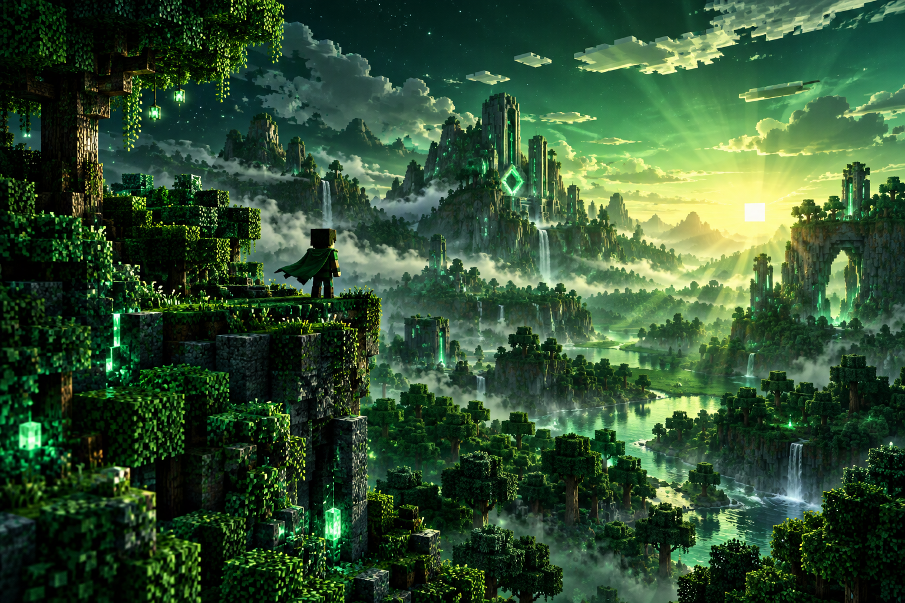

<div align="center">



# ⛏️ HeowoiblerieMC

### Voxel worlds. Web experiments. Original game projects.

<p>
  
  
  
</p>

<p>
  <strong>Building original browser games with JavaScript, Three.js, and way too many blocks.</strong>
</p>

</div>

---

## 🟩 About Me

```text
Player:     HeowoiblerieMC
Class:      Student Developer
Location:   Kobe, Japan
Specialty:  Browser Games and Voxel Worlds
Current XP: Always Increasing
Status:     Creating the Next Project
```

I create interactive web projects inspired by voxel games, sandbox worlds, driving simulations, and competitive game modes. My goal is to turn ideas into playable experiences that run directly in the browser.

> **The world is made of blocks. The future is made of code.**

---

## 🧱 Featured Projects

<table>
  <tr>
    <td width="50%" valign="top">
      <h3>✦ Nova Client</h3>
      <p>A browser-based voxel game project focused on responsive controls, block interaction, custom interfaces, and competitive training modes.</p>
      <p>
        
        
        
      </p>
      <a href="https://heowoibleriemc.github.io/nova-client/">
        
      </a>
    </td>
    <td width="50%" valign="top">
      <h3>🚘 Nova Drive 2.0</h3>
      <p>A detailed Three.js driving environment with roads, sidewalks, medians, crosswalks, vehicles, street trees, lamps, and a custom HUD.</p>
      <p>
        
        
        
      </p>
    </td>
  </tr>
</table>

---

## ⚔️ Current Quest

```text
[██████████████░░░░░░] 70%  Nova Client
[████████████░░░░░░░░] 60%  BedFight Training
[██████████░░░░░░░░░░] 50%  Nova Drive 2.0
[██████░░░░░░░░░░░░░░] 30%  New Experiments
```

### Now Building

- 🛏️ A BedFight practice mode with a challenging bot
- 🌉 Speed Bridge mechanics and block placement training
- 🎮 Keyboard, mouse, and touch controls
- 🧊 Original voxel textures and interfaces
- 🚦 Traffic lights and road systems for Nova Drive 2.0
- ⚡ Performance improvements for browsers and iPad

---

## 🛠️ Tech Inventory

<div align="center">


<br><br>

| Slot | Technology | Usage |
|:---:|:---|:---|
| `1` | HTML5 | Structure and game interfaces |
| `2` | CSS3 | Responsive HUDs and visual design |
| `3` | JavaScript | Gameplay, controls, and world logic |
| `4` | Three.js | 3D rendering and voxel environments |
| `5` | WebGL | Hardware-accelerated browser graphics |
| `6` | GitHub Pages | Publishing playable projects |

</div>

---

## 📊 Player Statistics

<div align="center">


<br>


</div>

---

## 🌲 Development Philosophy

```javascript
const developer = {
  username: "HeowoiblerieMC",
  favoriteStyle: "Voxel and Dark Green",
  currentMission: "Build playable browser worlds",
  rule: "Keep improving until it feels right"
};
```

- Build projects that can be played, not only viewed
- Make controls feel responsive on both desktop and touch devices
- Use original designs while keeping the familiar voxel atmosphere
- Improve one system at a time until the whole experience feels complete

---

## 🏆 Achievements

<p align="center">
  
</p>

---

## 🔗 Connect

<div align="center">

<a href="https://github.com/HeowoiblerieMC">
  
</a>
<a href="https://heowoibleriemc.github.io/nova-client/">
  
</a>

<br><br>

### 🌟 Thanks for visiting my world.

<sub>Original voxel banner created for this profile. This profile is not affiliated with Mojang Studios or Microsoft.</sub>

</div>
